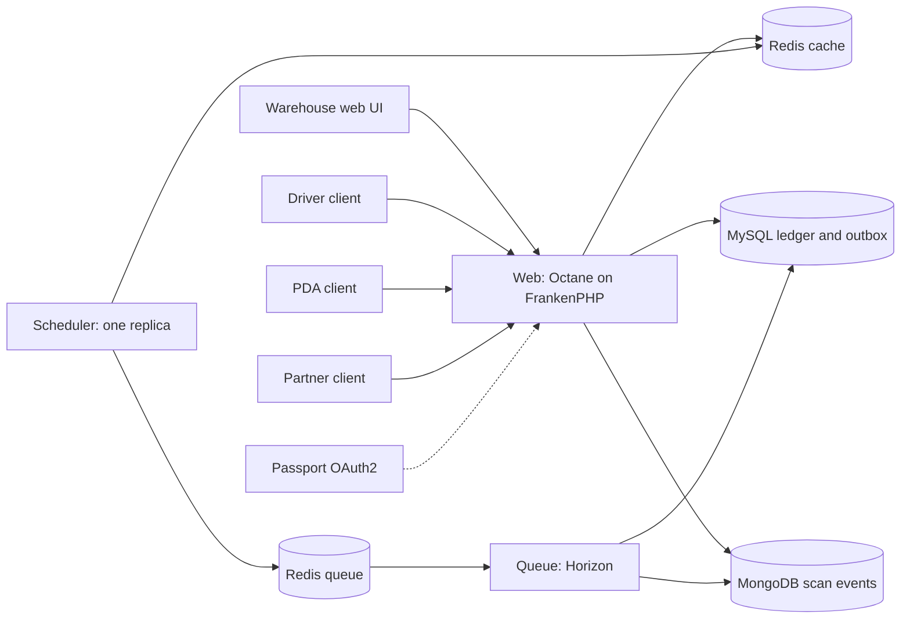

# Quay logistics platform

This document is the architecture for the greenfield platform. It preserves the design decisions, compatibility caveats, quality gates, operational constraints, phases, and sources, and records what this private draft actually built.

The design was checked against published package metadata on 6 November 2026. This draft then resolved and tested a subset of that matrix on PHP 8.5.12. Published constraints were not treated as proof of compatibility.

## Scope and status

| Topic | Decision | Status |
| --- | --- | --- |
| Scope | Greenfield build. Existing PHP 7.4/8.1 Lumen and Eloquent systems inform the technology choice only. Upgrading them, migrating their data, and staying compatible with them are out of scope. | Confirmed |
| Repository | A new repository. The design assumed GitHub. This workspace is a private Origin draft. It is not a GitHub repository, it has not been published, and no pull request exists. | Draft only |
| Framework | Laravel 13 with Eloquent. The design recommended it and left formal acceptance open. The implementation request accepted Laravel and Eloquent for this draft. | Accepted for this draft |

Symfony 8.1 with Doctrine and API Platform remains the alternative only if a later decision rejects Laravel. It was not built.

## Verified versions

Latest stable releases checked on 6 November 2026. The lockfile in this repository is the tested set. Do not use floating image tags in production. Pin images by digest.

| Component | Latest stable checked | Constraint / evidence | This draft |
| --- | --- | --- | --- |
| PHP | 8.5.12 (22 Oct 2026). 8.5.13 was still a release candidate. | Stable line. | Required as `8.5.*`. Composer and tests ran on 8.5.12. |
| FrankenPHP | v1.13.5 (5 Nov 2026) | Worker mode resets some state and not `$_ENV` or engine state. | Image `dunglas/frankenphp:1.13.5-php8.5.12-trixie` pinned by digest. |
| laravel/framework | v13.40.0 | PHP `^8.3`. Laravel 13 supports PHP 8.3–8.5. | Locked v13.40.0. Resolved on PHP 8.5.12. |
| laravel/octane | v2.23.0 | PHP `^8.2`, Laravel 11–13. | Locked. FrankenPHP driver. |
| laravel/horizon | v5.50.1 | PHP `^8.0`, Laravel up to 13. | Locked. |
| laravel/passport | v13.10.0 | PHP `^8.2`, Laravel up to 13. | Locked. Client-credentials grant is what the slice tests. |
| larastan/larastan | v3.14.0 | PHP `^8.2`, Laravel 13, PHPStan 2.x. | Locked with PHPStan 2.3.5. Level 8. |
| laravel/pint | v1.32.1 | PHP `^8.3`. PHP 8.5 runtime support was unverified in the design. | Ran successfully on PHP 8.5.12. Application code avoids newer syntax Pint may not parse. |
| PHPUnit | 13.4.6 is the current major. | Laravel 13.11's skeleton requires `phpunit/phpunit: ^12.5.12`. | Locked 12.5.43. PHPUnit 13 was not forced. |
| ext-mongodb / mongodb/mongodb | 2.5.7 / 2.5.1 | Library requires `ext-mongodb: ^2.5`. | Library 2.5.1 locked. Host extension is the distro build 2.5.5. The image installs PECL 2.5.7. |
| ext-redis | 6.3.0 (Nov 2025) | No newer stable release. | Loads on PHP 8.5.12. The image installs 6.3.0. |
| league/openapi-psr7-validator | 0.24 | Describes itself as an OpenAPI 3.0.2 validator. | Not used. It is the wrong dialect for a 3.1 contract. |
| OpenAPI contract tests | studio-design/gesso 2.9.0 | PHP `^8.3`, PHPUnit 12 or 13, OpenAPI 3.1 via opis/json-schema 2.6. | Locked. `gesso doctor` reported the spec as OpenAPI 3.1.0. |
| OpenTelemetry PHP SDK / extension | SDK 1.16.1 does not require the C extension. PECL stable extension is 1.4.2. Ubuntu's `php8.5-opentelemetry` package is 1.2.1. | Auto-instrumentation under Octane was not verified. | Not installed. Logs carry `trace_id` and `span_id`. OTLP export is opt-in and off by default. The visualization target is Grafana, not SigNoz. No collector endpoint is configured. |
| ext-pdo_mysql | Bundled with PHP 8.5.12. | Ships with php-src. | Used. |

## Framework recommendation

Laravel 13 and Eloquent are the stack for this draft.

Reasons:

- The team already knows Eloquent and Illuminate, coming from Lumen.
- Octane has a FrankenPHP driver for long-lived web workers.
- Redis queues with Horizon provide supervision, metrics, and failed-job tooling.
- The scheduler supports `onOneServer()` and `withoutOverlapping()`.
- Passport is a first-party OAuth2 server.

Caveats that still apply:

- Lumen habits do not carry over. This project is full Laravel.
- Inventory changes live in action classes, not model events.
- Static properties, singletons holding request data, and FrankenPHP's unreset `$_ENV` can leak across requests.
- OpenAPI is maintained by hand. It is not generated from controllers.
- Symfony with Doctrine remains an unbuilt alternative.

## System architecture

One modular-monolith Laravel codebase is built into one image and run as three roles. MongoDB is only for device scan documents.

| Module | Owns in the design | Store | Shipped in this draft |
| --- | --- | --- | --- |
| Catalog and locations | SKUs, bins, zones | MySQL | SKU and location registration |
| Inventory | Ledger, balances, reservations | MySQL | Receipts, holds, releases, consume |
| Inbound / outbound | Receiving, putaway, picking, packing | MySQL | Receiving only. Putaway, picking, and packing are deferred |
| Planning | Waves, routes, dock slots | MySQL, Redis cache | Deferred |
| Delivery | Stops, statuses, proof of delivery | MySQL; files in object storage | Stop state machine. No proof files |
| Device sync | Offline command intake, idempotency | MySQL | HTTP idempotency keys only |
| Partner API | Clients, scopes, webhooks | MySQL | Scoped client credentials. No webhooks |
| Telemetry and audit search | GPS breadcrumbs, scan events | MongoDB | Bounded scan events. Audit of stock changes stays in MySQL |

Each module lives under `app/Modules/*`. Modules call each other through public action classes. They do not use each other's Eloquent models. PHPStan runs PHPat rules for that boundary.

The HTTP layer calls actions. A small `CountPendingMessages` action keeps the metrics endpoint off the outbox model.

## Data stores and consistency

MySQL is the source of truth for stock. Movements are append-only: `StockMovement` throws if updated or deleted. Each receipt, hold, release, and consume runs in `DB::transaction(..., 3)` so deadlocks retry. The balance row is locked with `lockForUpdate()`, then updated with a `version` predicate. Locks in this slice cover one balance row. A later multi-row operation must take locks in a deterministic order. Unique keys on idempotency fields prevent double booking. This logic is in action classes.

The outbox row is written in the same transaction as the reservation. A relay command leases pending rows with `FOR UPDATE SKIP LOCKED` and only then pushes a queue job. The message is marked processed after the consumer's own transaction inserts a `processed_messages` row. Redis being down at commit time does not lose the business change. Consumers deduplicate on message id. There is no cross-database atomic transaction: MySQL, Redis, and MongoDB commit independently.

Redis is two processes, not two database indexes on one process:

- Cache Redis uses `allkeys-lru`, no AOF, and holds sessions, rate limits, scheduler locks, and metric counters. It can be rebuilt.
- Queue Redis uses `noeviction` and AOF `appendfsync everysec`. A full queue fails writes instead of evicting jobs. A crash can still lose about one second of acknowledged writes. Failover can lose acknowledged jobs. Jobs are at-least-once. The outbox can lease them again when the lease expires.

A dedicated broker such as SQS or RabbitMQ can replace the queue Redis later. The outbox boundary stays.

MongoDB stores device scan events. A scan has a symbology, a payload of at most 512 characters, and a small device object (`model`, `firmware`). A JSON schema validator rejects anything larger. Scan documents are not stock, not orders, and not proof-of-delivery files. Proof files, if they are added later, belong in object storage with metadata elsewhere. The official `mongodb/laravel-mongodb` package is the integration.

SQL is parameterized through the query builder or Eloquent. Review new queries with `EXPLAIN` on a staging copy. Do not run `EXPLAIN ANALYZE` on mutating statements in production. Indexes are listed in [sql.md](operations/sql.md). No static tool proves that a query is fast.

## Queues, scheduler, and runtime

Idempotent jobs insert the message id into `processed_messages` inside the job transaction. `ShouldBeUnique` and `WithoutOverlapping` are not used as the guarantee.

`DeliverOutboxMessage` sets `$tries = 5`, `backoff()` of 1, 5, 15, and 60 seconds, and `retryUntil()` of 15 minutes. Horizon's supervisor `tries` is 5 so it does not override the job back to one attempt. `failed_jobs` is the dead-letter table. Alert on its growth. `php artisan queue:retry` is the replay command, and only after the cause is understood.

One scheduler container runs `schedule:work`. `outbox:relay` and `ops:heartbeat` use `onOneServer()` and `withoutOverlapping()` with expiries of 5 minutes and 2 minutes. Those locks live on the cache Redis. A crashed task holds its lock until the expiry. Do not scale the scheduler past one replica. The web container does not embed the scheduler.

Horizon and the scheduler receive `SIGTERM` because the entrypoint `exec`s the process. Compose sets `stop_grace_period: 70s`, which is longer than the 60 second worker timeout and the 30 second job timeout. On deploy, run `php artisan horizon:terminate` and let the old workers finish. Workers recycle after 1000 jobs or 3600 seconds, with a 128 MB memory limit.

Octane resets framework state between requests. This app also clears `CorrelationContext` on Octane's `RequestReceived` event and flushes that binding. `max_requests` is 500. Do not store request users, tokens, or warehouse ids in static properties. FrankenPHP does not reset `$_ENV`; read configuration through `config()`, which is loaded once per worker. A test dispatches the same listener Octane runs and checks that correlation state is cleared. That is not a multi-process FrankenPHP soak test.

`/up` is process liveness and does not touch databases. `/ready` checks MySQL, both Redis processes, and MongoDB, and returns only boolean checks. Horizon status and `ops:heartbeat-status` cover the background roles.

Migrations run as `php artisan migrate --force --isolated` in a one-off Compose service. The entrypoint does not migrate. Use expand-and-contract for production schema changes. The runtime database user is granted DML only. The migrator user is separate and is used by the one-off migrate service and by PHPUnit.

## APIs, auth, and clients

| Client | Auth in the design | What this draft does |
| --- | --- | --- |
| Warehouse web UI | OIDC session, or Sanctum SPA / BFF. Roles per warehouse. | Session login. Operator can mutate. Planner can read. One warehouse code on the user. |
| Driver app | Authorization code and PKCE, refresh tokens, device binding. | Not a native app. A `driver-mobile` client-credentials client and the delivery/scan HTTP contract. |
| PDA | Per-device client plus user login with PKCE. Fast user switch on shared devices. | Not a device app. A `pda-scanner` client and `POST /api/v1/scan-events`. |
| Partners | Client credentials, scopes, per-client rate limit, signed webhooks. | `partner:*` clients, scopes, and a lower rate limit. No webhooks. |

Passport issues client-credentials tokens at `POST /oauth/token`. Scopes are `inventory.read`, `inventory.write`, `delivery.read`, `delivery.write`, and `telemetry.write`. Clients store an allowed scope list; Passport drops requested scopes the client does not have. Access tokens expire in 15 minutes. Authorization code and PKCE are the intended user login for drivers and PDAs and are not implemented. Replacing Passport with an external OIDC resource server means keeping the same bearer-token and scope checks.

The OpenAPI 3.1 document at [docs/api/openapi.yaml](api/openapi.yaml) is the source of truth. Redocly lints it. Gesso, which understands the 3.1 JSON Schema dialect, checks feature-test responses. `oasdiff` v1.35.0 compares pull requests with the base spec. Versioning is the `/api/v1` path. API errors are `application/problem+json` using the RFC 9457 members `type`, `title`, `status`, `detail`, and `instance`, plus `request_id`. The token endpoint keeps Passport's OAuth2 error body. Every API `POST` requires an `Idempotency-Key` UUID. Replaying the same body returns the stored response. A different body with the same key returns 409.

Offline sync beyond that key is deferred. Devices would queue commands with client UUIDs and the server would apply them idempotently. Conflicts would follow server rules, for example when a line is already reserved. Proof of delivery needs a retention policy, least-privilege access, and a GPS privacy notice before any file storage is added. Native, cross-platform, and PWA choices, and the PDA scanner SDK, are open. Do not invent them here. Client boundaries are described in [clients.md](api/clients.md).

## Quality and security gates

Budgets are starting values. They are configurable. No static tool proves that SQL is safe or fast.

| Gate | Tool | Blocks a change? | This draft |
| --- | --- | --- | --- |
| Code style | Pint, Laravel preset | Yes | Runs on PHP 8.5.12 |
| Static analysis | Larastan level max, PHPStan strict-rules, deprecation rules, phpstan-phpunit | Yes | `staticMethod.dynamicCall` is excluded because it flags Eloquent's `__call` API. See `phpstan.neon`. The playbook adoption record is [engineering-playbook-adoption.md](engineering-playbook-adoption.md). |
| Architecture | PHPat: no cross-module model access | Yes | Four rules |
| Tests | PHPUnit against MySQL, two Redis processes, and MongoDB | Yes | 17 tests, real services |
| SQL warnings | Strict MySQL mode, `Model::shouldBeStrict()`, query-count assertion | Yes | Default budget is 15 queries |
| Slow queries | Per-query log when `event->time` exceeds `SLOW_QUERY_MS` (default 200). Staging slow log at 0.2 s is proposed. `EXPLAIN` review on new queries | Review | Laravel's `whenQueryingForLongerThan` is cumulative and fires once per connection, which is the wrong signal on an Octane worker. The listener checks each query instead. |
| OpenAPI | Redocly lint, Gesso response checks, oasdiff on pull requests | Yes | Doctor reports 3.1.0 |
| Dependencies | `composer audit`. Snyk Open Source for high severity | Yes | `composer audit` is clean as of this draft. Snyk fails closed without `SNYK_TOKEN`. |
| SAST | Snyk Code, if the plan includes it | Yes when entitled | Same fail-closed job. A plan that rejects Code fails the job. |
| Container | Snyk Container on the built image | Yes for high severity when entitled | Same job |
| IaC | Snyk IaC on the Dockerfile and Compose | Advisory in the design; this workflow fails the job if the CLI fails | Not a substitute for review |
| Secrets | GitHub secret scanning and push protection | Yes, once the GitHub repository exists | Cannot be enabled from this Origin draft |

The Snyk job is in `.github/workflows/ci.yml`. If `SNYK_TOKEN` is empty it exits 1 before any scanner runs. It does not skip and turn green. Required secret: `SNYK_TOKEN`. Code, Container, and IaC need a Snyk plan that includes them. This draft has no token, so that job is expected to fail until someone adds a licensed token. `composer audit` still runs in the quality job.

GitHub secret scanning and push protection are repository settings. Turn them on when the GitHub repository is created. This draft does not claim they are active.

## Observability

Logs go to stderr as JSON through Monolog. A processor redacts passwords, secrets, tokens, authorization headers, cookies, and bearer strings. Laravel `Context` carries `request_id`, `trace_id`, and `span_id`. The web role reads both ids from a W3C `traceparent` header or generates them. The outbox consumer and the scheduler heartbeat do the same for their own log lines. Jobs add `job_id` when the queue provides one. These ids are log correlation. They are not exported OpenTelemetry spans. Grafana is the intended place to view telemetry once a collector exists. SigNoz is not the target. `TELEMETRY_EXPORT` stays false until `OTEL_EXPORTER_OTLP_ENDPOINT` names a collector the operator runs.

Business audit rows (who changed stock) are inserted in the same MySQL transaction as the change. They are not log lines.

`/metrics` is hand-written Prometheus text: an HTTP counter stored on the cache Redis, a pending-outbox gauge from MySQL, and the scheduler heartbeat age. Cache eviction can drop the counter. That is acceptable for a counter and is not how the queue is stored. Set `METRICS_TOKEN` outside local development and send it as a bearer token. The endpoint does not include DSNs or secrets.

Compose does not start Grafana, a collector, Loki, Tempo, Mimir, or Alloy. Those addresses are not invented here. Horizon exposes its own metrics inside the dashboard, which requires an authenticated operator and is closed to anonymous users even when `APP_ENV=local`.

## Deployment and operations

Compose is for development and the CI service containers. The production orchestrator is not chosen. The image is multi-stage, pinned by digest, and the entrypoint drops to uid 1000 with `setpriv` after fixing storage ownership. Web, Horizon, and the scheduler share the image and differ by command. Only the web role publishes a port, and the dev Compose file binds it to `127.0.0.1`.

Use managed MySQL with point-in-time recovery and scheduled restore drills. Back up MongoDB as well. Redis cache can be rebuilt. Queue durability rests on the outbox plus the queue Redis AOF, which is still not a database. Secrets come from the environment or the orchestrator's secret store. They are not baked into the image. Passport keys are generated into the storage volume only when `APP_ENV=local` and the files are missing. Any other environment must mount `PASSPORT_PRIVATE_KEY` or the key files. Data stores sit on a private network.

Local passwords in `.env.example` are development defaults. They are not production secrets.

## Phased delivery

The design's original estimates are preserved here as estimates from that document, not as a schedule this draft commits to.

1. Phase 0, foundation: new repo, images, Compose, CI gates, the Laravel decision, auth server choice, OpenAPI skeleton, and spikes for ext-redis, Pint, and OpenTelemetry on PHP 8.5.
2. Phase 1, MVP: inventory ledger and reservations, inbound receiving, outbound picking and packing, warehouse web UI, outbox, and Horizon. Out of scope there: route optimisation and partner webhooks.
3. Phase 2: driver delivery flow, proof of delivery, offline sync, PDA scanning flows.
4. Phase 3: partner API general availability, planning and optimisation, and a dedicated broker if Redis limits become a problem.

This draft completed a foundation and a thin slice of phase 1: receipts, reservations, delivery state, the outbox, a small warehouse UI, and scan-event intake. Picking, packing, putaway, waves, routes, proof of delivery, offline sync, webhooks, and native clients are not built. See [implementation-status.md](implementation-status.md).

The design warned that package compatibility had not been tested together on PHP 8.5. This draft tested the locked set on PHP 8.5.12 for the code that is here. That is not a certification of every transitive package under Octane in production.

## Open questions

1. Who formally accepts the Laravel recommendation for the organisation, and what is the GitHub workflow once a repository exists: branch protection, reviewers, release cadence?
2. Which PDA hardware and scanner SDK will be used, how long must devices work offline, and will devices be shared between users?
3. Is the driver client native, cross-platform, or a PWA?
4. Which production orchestrator and cloud, and which managed MySQL, Redis, and MongoDB services?
5. Will production keep Passport or switch to an external identity provider? The bearer and scope boundary is the swap point.
6. Which Snyk plan is available? Does it include Code, Container, and IaC?

## Sources

- [PHP releases](https://www.php.net/releases/)
- [PHP 8 changelog](https://www.php.net/ChangeLog-8.php)
- [FrankenPHP worker mode](https://frankenphp.dev/docs/worker/)
- [FrankenPHP releases](https://github.com/php/frankenphp/releases)
- [Laravel framework releases](https://github.com/laravel/framework/releases)
- [Laravel release notes](https://laravel.com/framework/docs/releases)
- [laravel/octane](https://packagist.org/packages/laravel/octane)
- [laravel/horizon](https://packagist.org/packages/laravel/horizon)
- [laravel/passport](https://packagist.org/packages/laravel/passport)
- [larastan/larastan](https://packagist.org/packages/larastan/larastan)
- [laravel/pint](https://packagist.org/packages/laravel/pint)
- [league/openapi-psr7-validator](https://packagist.org/packages/league/openapi-psr7-validator)
- [studio-design/gesso](https://packagist.org/packages/studio-design/gesso)
- [phpredis releases](https://github.com/phpredis/phpredis/releases)
- [MongoDB PHP driver](https://github.com/mongodb/mongo-php-driver/releases)
- [OpenTelemetry PHP](https://opentelemetry.io/docs/languages/php/)
- [Snyk CLI](https://docs.snyk.io/snyk-cli)
- [RFC 9457 Problem Details](https://www.rfc-editor.org/rfc/rfc9457)
- Docker Hub tag metadata for `dunglas/frankenphp`, `mysql`, `redis`, and `mongo`, read on 6 November 2026

## Deviations from the design

| Design | Evidence | What this draft did |
| --- | --- | --- |
| Laravel was recommended, not accepted | The implementation request accepted Laravel and Eloquent and said not to ask again | Laravel 13 is the stack. Organisational sign-off is still an open question |
| Separate Redis databases | Database indexes share eviction and process failure | Two Redis services |
| `league/openapi-psr7-validator` | Version 0.24 documents OpenAPI 3.0.2 | Gesso 2.9.0 for 3.1 response checks, Redocly for lint, oasdiff for breaking diffs |
| PHPUnit 13.4.6 | `laravel/laravel` 13.11 requires PHPUnit `^12.5.12` | PHPUnit 12.5.43 |
| OpenTelemetry collector in the architecture diagram | SDK 1.16.1 has no C-extension requirement, but the distro extension is 1.2.1 while PECL is 1.4.2, and Octane auto-instrumentation was not verified | No collector and no claim of traces. Log correlation and `/metrics` only |
| `DB::whenQueryingForLongerThan` | It accumulates time and fires once per connection | Per-query listener |
| Passport or external OIDC for every client, including authorization code and PKCE | A native or browser login was not specified | Passport client credentials for the API slice. Session auth for the warehouse UI. PKCE deferred |
| MongoDB for proof-of-delivery metadata | The request forbids giant proof blobs | Scan events with a 512 character payload cap |
| Snyk as a blocking gate | No token is available | The workflow fails closed instead of skipping green |
| Durations of 2–3 weeks and 6–8 weeks | Calendar estimates were in the design | Recorded above as the design's estimates, not this draft's plan |
